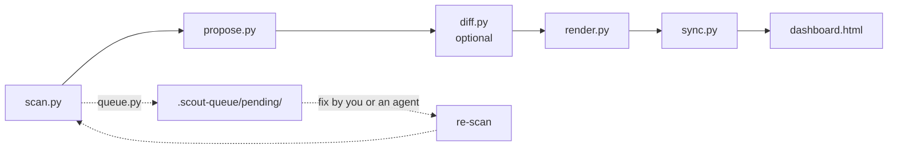

# Scout

[](https://github.com/Alpha-Oi/scout/actions/workflows/verify.yml)
[](https://www.python.org/downloads/)
[](https://opensource.org/licenses/MIT)
[](https://github.com/Alpha-Oi/scout/commits/main)

**Read-only project scanner with a dashboard.**
Runs up to 14 detectors (bugs, vulnerabilities, secrets, dead code, style), shows
the findings in one HTML page and proposes one concrete action for each.
It finds and proposes, it never edits your project.

**English** · [Русский](README.ru.md)

<br clear="left" />


*The dashboard UI and the proposals are in Russian; the data (files, lines, evidence) is language-neutral.*

---

## Try it in one minute

No project of your own and no extra tools required, only Python 3.11+:

```sh
git clone https://github.com/Alpha-Oi/scout.git
cd scout
python examples/demo.py --open
```

The demo creates a tiny project with typical problems (a hard-coded key, `eval`,
`shell=True`, a TODO), scans it, "fixes" it, re-scans, and opens the dashboard
with the before/after diff. Everything is written to a temp folder.

## Scan your own project

```sh
python tools/doctor.py --check            # which detectors are available
python tools/doctor.py                    # (optional) install the missing ones

python tools/scout.py ~/projects/my-app   # scan, proposals, diff, dashboard, open
```

One command runs the whole pipeline and opens `.scout/dashboard.html` (a plain file,
no server needed). Run it again after fixing things: it finds the previous run of the
same project by itself and fills the **Diff** tab. Real output:

```
scout: 4 findings → .scout/2026-10-13-my-app  (2.1s)
  critical 1
  low      3

Дашборд: .scout/dashboard.html
```

Options: `--out DIR` (reports folder, default `./.scout`), `--quick` (skip the slow
`pytest-failed` and `pip-audit`), `--max-findings N`, `--llm`, `--no-open`.
On Linux/macOS use `python3` if `python` is not found.

Prefer step by step? The individual tools are listed under [How it works](#how-it-works),
and the [guide](docs/guide.md#2-первый-скан) shows the manual order.

**As a skill** in Claude Code, Cursor or Codex, the agent runs all phases for you:

```
/scout ~/projects/my-app
/scout quick ~/projects/my-app
```

See the [guide](docs/guide.md#6-работа-через-claude-code--cursor--codex) for installing it as a skill.

## What you need to know

- **Read-only.** Scout never writes into the scanned project; reports go to `--out` (default `./.scout`).
  Two caveats: external detectors run inside the project and may leave their own caches
  (`.mypy_cache`, `.ruff_cache`), and `pytest-failed` **runs your project's tests**
  (skip it with `--quick` for code you don't trust).
- **Missing tool = skipped detector.** Nothing is faked. With no extra tools installed you still get
  the two built-in detectors (`secrets`, `todo-fixme`).
- **Mostly for Python projects.** `secrets` and `todo-fixme` work on any text language, the rest are Python tools.
- **Findings are signals.** Every finding carries file, line and raw detector output so you can check it.
- **Deterministic.** The same findings give the same proposals. LLM proposals are opt-in (`--llm`).

## Documentation

Most of the documentation is in Russian.

| Page | Contents |
|---|---|
| [Guide](docs/guide.md) | install, first scan, reading the dashboard, diff, task queue, skill mode, LLM |
| [Examples](docs/examples.md) | before/after, recipes (CI, SARIF, quick scan), case study |
| [Configuration](docs/configuration.md) | `.scoutrc`: every option with scenarios |
| [Detectors](docs/detectors.md) | what each of the 14 detectors finds and what to do about it |
| [Troubleshooting](docs/troubleshooting.md) | symptom → cause → fix |
| [Case studies](docs/case-studies.md) | Scout scanning itself, what CI caught |

## How it works



| Command | Purpose |
|---|---|
| `scout.py <project>` | **all of the below in one go**, then opens the dashboard |
| `scan.py <project> --out <dir>` | run detectors, write `findings.json` and `scan.log` |
| `propose.py <run>` | write `proposals.json` (rules, or `--llm`) |
| `diff.py <old-run> <new-run>` | compare two runs → `diff.json` (run **before** `render.py`) |
| `render.py <run>` | build `state.js` from findings + proposals + diff |
| `sync.py <dir>` | inline `state.js` into `dashboard.html` |
| `queue.py <run>` | turn findings into task files in `.scout-queue/pending/` |
| `doctor.py [--check] [--yes]` | check / install detector tools |

`scan.py` flags: `--out`, `--run-name`, `--quick`, `--max-findings N`.
`queue.py` flags: `--severity {critical,high,medium,low,all}`, `--detector`, `--limit`, `--dry`.

## Detectors

| Detector | Category | What it finds | Requires |
|---|---|---|---|
| `pytest-failed` | bug | failing tests | pytest |
| `pip-audit` | vuln | known CVEs in dependencies | pip-audit |
| `pip-outdated` | improvement | outdated dependencies (no CVE) | pip |
| `bandit` | vuln | eval, subprocess shell, weak crypto | bandit |
| `ruff` | bug / improvement | undefined names, unused imports, style | ruff |
| `mypy` | bug | type errors | mypy |
| `vulture` | improvement | dead code | vulture |
| `radon` | improvement | cyclomatic complexity > 10 | radon |
| `interrogate` | improvement | missing docstrings | interrogate |
| `pyscn` | improvement | code clones | uv |
| `semgrep` | vuln | SAST with curated rules | semgrep |
| `detect-secrets` | vuln | entropy-based secrets | detect-secrets |
| `todo-fixme` | incomplete | TODO / FIXME / XXX / HACK | built-in |
| `secrets` | vuln | regex API keys, tokens, passwords | built-in |

## Finding format

```json
{
  "id": "sha1:abc123",
  "category": "bug|vuln|incomplete|improvement",
  "severity": "critical|high|medium|low",
  "title": "short line",
  "file": "relative/path",
  "line": 42,
  "evidence": "raw detector output",
  "detector": "name",
  "detected_at": "ISO-8601",
  "fingerprint": "detector:file:line:title"
}
```

The fingerprint is stable between runs; that is what makes the diff possible.

## Repository layout

```
scout/
  SKILL.md              skill entrypoint (phases, rules)
  phases/               per-phase rules, read one at a time
  tools/                runtime: scout (one command), scan, propose, diff, render, sync, queue, doctor
  scripts/              verify-skill.py, build-adapters.py
  examples/demo.py      one-command demo
  docs/                 guide, examples, configuration, detectors, troubleshooting
  AGENTS.md / CLAUDE.md / .cursor/rules/   adapters for Codex / Claude Code / Cursor
  .scoutrc.example      config template
```

Integrity check: `python scripts/verify-skill.py` → `scout check: OK`.

## License

MIT. See [LICENSE](LICENSE).
