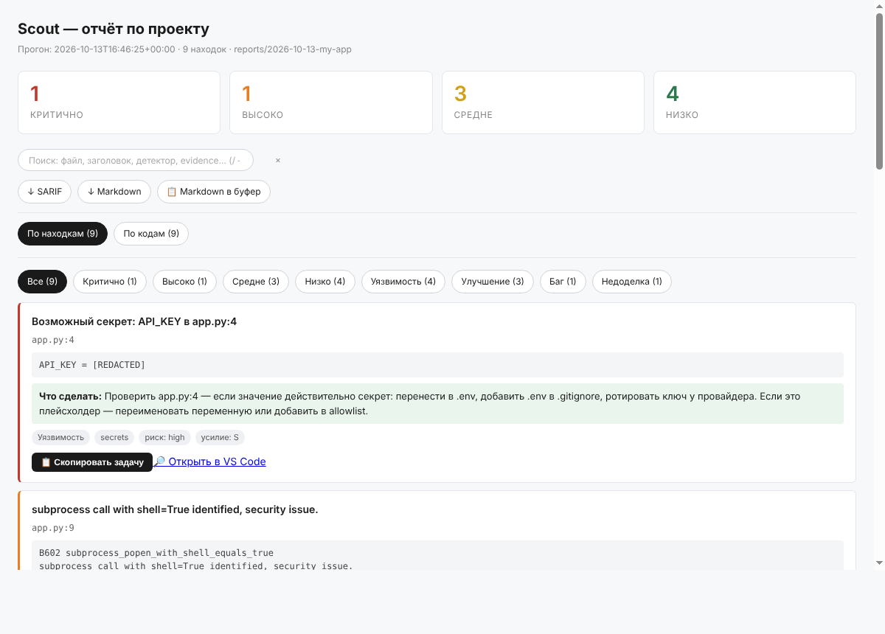
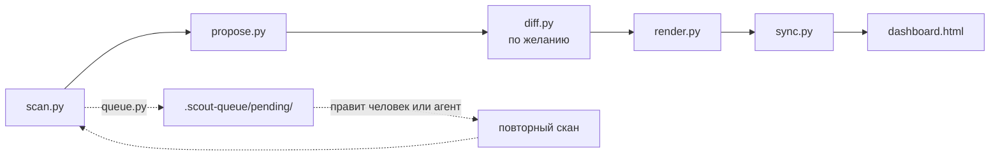

# Scout

[](https://github.com/Alpha-Oi/scout/actions/workflows/verify.yml)
[](https://www.python.org/downloads/)
[](https://opensource.org/licenses/MIT)
[](https://github.com/Alpha-Oi/scout/commits/main)

**Сканер проекта с дашбордом. Только читает, ничего не правит.**
Запускает до 14 детекторов (баги, уязвимости, секреты, мёртвый код, стиль),
собирает находки на одной HTML-странице и к каждой предлагает одно конкретное действие.

[English](README.md) · **Русский**

<br clear="left" />



---

## Попробовать за минуту

Свой проект и дополнительные инструменты не нужны, только Python 3.11+:

```sh
git clone https://github.com/Alpha-Oi/scout.git
cd scout
python examples/demo.py --open
```

Демо создаёт мини-проект с типичными проблемами (ключ в коде, `eval`, `shell=True`,
TODO), сканирует его, «чинит», сканирует ещё раз и открывает дашборд с diff «было → стало».
Всё пишется во временную папку, ваши файлы не затрагиваются.

## Просканировать свой проект

```sh
python tools/doctor.py --check            # какие детекторы доступны
python tools/doctor.py                    # (по желанию) поставить недостающие

python tools/scout.py ~/projects/my-app   # скан, предложения, diff, дашборд, открыть
```

Одна команда проходит весь конвейер и открывает `.scout/dashboard.html` (обычный файл,
сервер не нужен). После исправлений запустите её снова: она сама найдёт прошлый
прогон этого проекта и заполнит вкладку **Diff**. Реальный вывод:

```
scout: 4 findings → .scout/2026-10-13-my-app  (2.1s)
  critical 1
  low      3

Дашборд: .scout/dashboard.html
```

Параметры: `--out DIR` (каталог отчётов, по умолчанию `./.scout`), `--quick` (пропустить
медленные `pytest-failed` и `pip-audit`), `--max-findings N`, `--llm`, `--no-open`.
На Linux/macOS, если нет `python`, используйте `python3`.

Хотите по шагам? Отдельные инструменты перечислены в разделе [«Как это устроено»](#как-это-устроено),
а ручной порядок описан в [руководстве](docs/guide.md#2-первый-скан).

**Как скилл** в Claude Code, Cursor или Codex агент пройдёт все фазы сам:

```
/scout ~/projects/my-app
/scout quick ~/projects/my-app
```

Или словами: «просканируй проект», «найди баги», «проверь проект на уязвимости».
Установка скилла: [руководство, раздел 6](docs/guide.md#6-работа-через-claude-code--cursor--codex).

## Что важно знать

- **Только чтение.** Scout не пишет в сканируемый проект; отчёты идут в `--out`
  (по умолчанию `./.scout`). Кэши `mypy`, `ruff`, `pytest` и файлы `.pyc` перенаправляются
  во временную папку (`$TMPDIR/scout-cache`, меняется переменной `SCOUT_CACHE_DIR`).
  Один нюанс: `pytest-failed` **запускает тесты вашего проекта**, а что пишут сами тесты,
  Scout не контролирует (для чужого кода используйте `--quick`).
- **Нет инструмента, нет детектора.** Ничего не подделывается. Даже без установки
  чего-либо работают два встроенных детектора: `secrets` и `todo-fixme`.
- **В основном для Python.** `secrets` и `todo-fixme` читают текст на любых языках,
  остальные детекторы это Python-инструменты.
- **Находка это сигнал, а не приговор.** В каждой есть файл, строка и сырой вывод
  детектора, чтобы вы могли проверить глазами.
- **Детерминированность.** Одинаковые находки дают одинаковые предложения.
  LLM включается только флагом `--llm`.

## Документация

| Страница | Что внутри |
|---|---|
| [Руководство](docs/guide.md) | установка, первый скан, чтение дашборда, diff, очередь задач, режим скилла, LLM |
| [Примеры](docs/examples.md) | «было → стало», рецепты (CI, SARIF, быстрый скан), кейс |
| [Настройка](docs/configuration.md) | `.scoutrc`: все параметры и типовые сценарии |
| [Детекторы](docs/detectors.md) | что находит каждый из 14 и что с этим делать |
| [Если что-то не работает](docs/troubleshooting.md) | симптом → причина → решение |
| [Кейсы](docs/case-studies.md) | Scout на самом себе, что поймал CI |

## Как это устроено



| Команда | Назначение |
|---|---|
| `scout.py <проект>` | **всё перечисленное ниже за один запуск**, затем открывает дашборд |
| `scan.py <проект> --out <каталог>` | запустить детекторы, записать `findings.json` и `scan.log` |
| `propose.py <прогон>` | записать `proposals.json` (правила или `--llm`) |
| `diff.py <старый> <новый>` | сравнить два прогона → `diff.json` (запускать **до** `render.py`) |
| `render.py <прогон>` | собрать `state.js` из находок, предложений и diff |
| `sync.py <каталог>` | вшить `state.js` в `dashboard.html` |
| `queue.py <прогон>` | разложить находки в задачи `.scout-queue/pending/` |
| `doctor.py [--check] [--yes]` | проверить / поставить инструменты детекторов |

Флаги `scan.py`: `--out`, `--run-name`, `--quick`, `--max-findings N`.
Флаги `queue.py`: `--severity {critical,high,medium,low,all}`, `--detector`, `--limit`, `--dry`.

## Детекторы

| Детектор | Категория | Что находит | Нужен |
|---|---|---|---|
| `pytest-failed` | bug | падающие тесты | pytest |
| `pip-audit` | vuln | известные CVE в зависимостях | pip-audit |
| `pip-outdated` | improvement | устаревшие зависимости (без CVE) | pip |
| `bandit` | vuln | eval, subprocess с shell, слабая криптография | bandit |
| `ruff` | bug / improvement | неопределённые имена, неиспользуемые импорты, стиль | ruff |
| `mypy` | bug | ошибки типов | mypy |
| `vulture` | improvement | мёртвый код | vulture |
| `radon` | improvement | цикломатическая сложность > 10 | radon |
| `interrogate` | improvement | нет docstring | interrogate |
| `pyscn` | improvement | клоны кода | uv |
| `semgrep` | vuln | SAST по готовым правилам | semgrep |
| `detect-secrets` | vuln | секреты по энтропии | detect-secrets |
| `todo-fixme` | incomplete | TODO / FIXME / XXX / HACK | встроен |
| `secrets` | vuln | ключи, токены, пароли по regex | встроен |

Подробнее и «что делать»: [docs/detectors.md](docs/detectors.md).

## Настройка

Необязательный файл `.scoutrc` в корне сканируемого проекта:

```json
{
  "skip_detectors": ["pyscn", "semgrep"],
  "severity_rules": { "todo-fixme": "low", "interrogate": "low" },
  "max_findings_per_detector": { "ruff": 200 }
}
```

Все параметры: [docs/configuration.md](docs/configuration.md), шаблон: [`.scoutrc.example`](.scoutrc.example).

## Формат находки

```json
{
  "id": "sha1:abc123",
  "category": "bug|vuln|incomplete|improvement",
  "severity": "critical|high|medium|low",
  "title": "короткая строка",
  "file": "относительный/путь",
  "line": 42,
  "evidence": "сырой вывод детектора",
  "detector": "имя",
  "detected_at": "ISO-8601",
  "fingerprint": "детектор:файл:строка:заголовок"
}
```

`fingerprint` стабилен между прогонами: на этом держится diff.

## Структура репозитория

```
scout/
  SKILL.md              точка входа скилла (фазы, правила)
  phases/               правила фаз, читаются по одной
  tools/                рантайм: scout (одна команда), scan, propose, diff, render, sync, queue, doctor
  scripts/              verify-skill.py, build-adapters.py
  examples/demo.py      демо одной командой
  tests/                тесты на unittest (только stdlib), запускаются в CI
  docs/                 руководство, примеры, настройка, детекторы, FAQ
  AGENTS.md / CLAUDE.md / .cursor/rules/   адаптеры для Codex / Claude Code / Cursor
  .scoutrc.example      шаблон конфигурации
```

Проверка целостности: `python scripts/verify-skill.py` → `scout check: OK`.
Тесты (только stdlib, ничего ставить не нужно): `python -m unittest discover -s tests`.

## Лицензия

MIT. См. [LICENSE](LICENSE).
